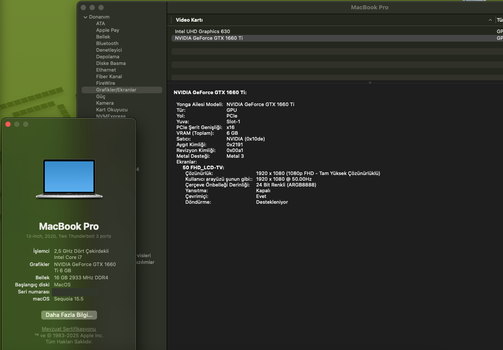

# ASUS TUF FX506LU Hackintosh (OpenCore)

ASUS TUF Gaming F15 **FX506LU** için OpenCore EFI'si. macOS 15.5 Sequoia'da test edildi.
Güncel sürüm, [nullmoth/nvidia-macos-driver](https://github.com/nullmoth/nvidia-macos-driver) ile
GTX 1660 Ti'yi (HDMI çıkışı üzerinden) Metal 3 hızlandırmayla çalıştıracak şekilde ayarlıdır.

> ⚠️ **SMBIOS bilgileri boştur.** Kullanmadan önce [GenSMBIOS](https://github.com/corpnewt/GenSMBIOS)
> ile kendi seri numaranızı, MLB, SystemUUID ve ROM değerlerinizi üretip `PlatformInfo` altındaki
> yer tutucuların yerine yazın (`Generic`, `DataHub`, `PlatformNVRAM`, `SMBIOS`).

## Sürümler

Her EFI sürümü bir git etiketiyle saklanır; eski sürümler her zaman indirilebilir.
Tüm sürümler: [Releases](../../releases) / [Tags](../../tags)

> NVIDIA'sız (dGPU kapalı, SIP açık) EFI ayrı bir depodadır:
> [atlntq/ASUS-TUF-FX506LU-Hackintosh](https://github.com/atlntq/ASUS-TUF-FX506LU-Hackintosh)

## Donanım

| Bileşen | Model | Durum |
|---|---|---|
| CPU | Intel Core i5-10300H (Comet Lake-H, 4 çekirdek / 8 iş parçacığı) | ✅ Tam güç yönetimi (XCPM) |
| iGPU | Intel UHD Graphics 630 (`0x3E9B0000`) | ✅ QE/CI, Metal 3, dahili ekranı sürer, parlaklık ayarı (`applbkl`) |
| dGPU | NVIDIA GeForce GTX 1660 Ti Mobile (TU116, `10de:2191`, 6 GB) | ✅ [nullmoth](https://github.com/nullmoth/nvidia-macos-driver) 2.9 ile Metal 3, yalnızca HDMI çıkışı; donanım H.264/HEVC kodlama; HDMI'sız açılışta oyunlar NVIDIA'da çizilip dahili ekrana verilir |
| Dahili ekran | 15.6" 1920×1080 @ 144 Hz (Intel'e bağlı) | ✅ Doğal çözünürlük ve tazeleme hızı |
| Harici ekran | HDMI (NVIDIA'ya bağlı) | ✅ 1080p 60 Hz, genişletme ve kopyalama (nullmoth 2.9'da TV açılışta takılı olmalı, aşağıya bakın) |
| RAM | 16 GB | ✅ |
| SSD (macOS) | JAMESDONKEY JD512 512 GB NVMe | ✅ |
| Ek disk | Crucial MX500 500 GB (SATA) | ✅ |
| Ses | Realtek ALC256 (`layout-id` 17) | ✅ Hoparlör, dahili mikrofon, kulaklık (uykudan sonra da, CodecCommander) |
| Wi-Fi | Intel Wi-Fi 6 AX201 (CNVi, `8086:06F0`) | ✅ AirportItlwm ile yerli Wi-Fi (menü çubuğu, HeliPort gerekmez), **Wi-Fi 6 (802.11ax)** açık (`itlwm_he=1`) |
| Bluetooth | Intel AX201 (`8087:0026`) | ✅ Açılıyor, cihaz eşleşiyor |
| Ethernet | Realtek RTL8111 | ✅ |
| Touchpad | ELAN I2C (`04F3:307A`) | ✅ Çoklu dokunma hareketleri (VoodooI2C) |
| Klavye | PS/2 | ✅ Fn parlaklık tuşları dahil |
| Kamera | USB2.0 HD UVC WebCam (`13D3:56A2`) | ✅ (görüntü varsayılan olarak karanlık; pozlamayı CameraController gibi bir uygulamayla ayarlayın) |
| Pil | — | ✅ Yüzde ve durum; KBColor menüsünde harcanan güç ve kalan süre |
| Uyku / uyanma | S3 | ✅ Kapak kapatma ve menüden uyku, adaptörde ve pilde (nullmoth 2.9, HDMI'sız açılış): kart ~3 s'de beklemeye geçiyor, uyanınca ~0,8 s'de dönüyor, sensörler ve Metal normal. HDMI takılıyken uyku ayrıca denenmedi |
| Klavye ışığı | RGB (tek bölge) | ✅ Fn+Yukarı/Aşağı ve Denetim Merkezi ile parlaklık; renk [KBColor](https://github.com/atlntq/ASUS-TUF-FX506LU-Hackintosh#keyboard-backlight) menü uygulamasından |
| Fan modu | Sessiz / Normal / Turbo | ✅ Fn+F5 veya [KBColor](https://github.com/atlntq/ASUS-TUF-FX506LU-Hackintosh#fan-mode) menüsü; fan hızları, sıcaklıklar ve güç tüketimi menüde; NVIDIA'nın sıcaklığı, gücü, saati ve yükü de |

**SMBIOS:** `MacBookPro16,3`

## OpenCore ve kextler

**OpenCore 1.0.8** (REL-108)

| Kext | Sürüm |
|---|---|
| Lilu | 1.7.2 |
| VirtualSMC / SMCProcessor / SMCBatteryManager | 1.3.8 |
| WhateverGreen | 1.7.1 |
| AppleALC | 1.9.8 |
| CodecCommander | 2.7.3 (uykudan sonra kulaklık sesi) |
| AMFIPass | 1.4.1 |
| ECEnabler | 1.0.6 |
| VoodooPS2Controller | 2.3.7 |
| VoodooI2C / VoodooI2CHID | 2.9.1 / 1.0 |
| AirportItlwm (Sequoia) | 2.4.0 |
| IntelBluetoothFirmware / IntelBTPatcher | 2.4.0 / 2.5.0 |
| BlueToolFixup | 2.7.2 |
| RealtekRTL8111 | 3.0.0 |
| AsusSMC | 1.4.1 |
| BrightnessKeys | 1.0.3 |
| USBMap | 1.0 (bu makineye özel) |
| KBColor | kext 1.1.0, [uygulama](https://github.com/atlntq/ASUS-TUF-FX506LU-Hackintosh/tree/main/KBColor) 1.5 (klavye ışığı rengi, fan modu, sensörler, NVIDIA sensörleri, NVIDIA ile aç; kendi kextim) |

Sürücüler: OpenRuntime, OpenCanopy, OpenHfsPlus, ResetNvramEntry.

## NVIDIA (GTX 1660 Ti) desteği

FX506LU'da MUX switch yoktur: dahili ekran Intel'e, **HDMI portu NVIDIA'ya** bağlıdır.
nullmoth sürücüsü kurulduğunda HDMI'deki ekran NVIDIA üzerinden Metal 3 ile çalışır,
dahili ekran Intel'de kalır.

NVIDIA için yapılan ayarlar:

- `ACPI > Add > SSDT-dGPU-Off.aml` **kapalı** (dosya duruyor), onun üç ACPI yeniden adlandırması
  (`_PTS`, `_WAK`, `EC0._REG`) da kapalı
- `DeviceProperties` > iGPU (`PciRoot(0x0)/Pci(0x2,0x0)`): `applbkl = 01000000`. NVIDIA açıkken
  WhateverGreen dahili panelin parlaklık yamasını kendiliğinden atlıyor; bu olmadan parlaklık ayarı görünmez.
- `-wegnoegpu` kaldırıldı
- boot-args: `nvfb=1 nvaccel=1 nvfbheads=4 -nvkmsnosmooth gfxrst=4 amfi_get_out_of_my_way=0x1 amfi=0x80 ipc_control_port_options=0 nvrmsettle=10000 itlwm_he=1`
  - `nvrmsettle=10000`: kartın BAR1 penceresi 256 MB ve taşınamadığı için nullmoth açılışta ekranı devralmadan önce
    100 saniye bekliyor. Bu laptopta açılış ekranı Intel'in belleğinde olduğu için bekleme gereksiz; bu ayarla 10 saniyeye
    iniyor (nullmoth'un Turing için normal süresi). nullmoth 2.9'da masaüstünün hangi kartta açılacağı kararı bu
    beklemeden sonra verildiği için ayar yalnızca açılışı kısaltıyor. 2.7.x'te kullanmayın: orada HDMI takılı açılışta
    masaüstünü NVIDIA'ya geçiriyor ve titreme / yüksek işlemci kullanımı yapıyordu.
  - `itlwm_he=1`: Wi-Fi 6 (NVIDIA'sız depodaki gibi).
- `Kernel > Block`: `com.apple.iokit.IONDRVSupport` (Exclude)
- `csr-active-config`: `430A0000`, `SecureBootModel`: `Disabled`
- AMFIPass.kext eklendi

> ⚠️ **Güvenlik:** Bu ayarlar SIP'i gevşetir, Secure Boot'u kapatır ve AMFI'yi devre dışı bırakır.
> İmzasız kernel uzantılarının yüklenebilmesi için gereklidir, ama sistemin güvenliğini ciddi
> şekilde azaltır. NVIDIA'ya ihtiyacınız yoksa [NVIDIA'sız EFI'yi](https://github.com/atlntq/ASUS-TUF-FX506LU-Hackintosh) kullanın.

### Kurulum

1. EFI'yi yerleştirin, SMBIOS'unuzu yazın ve açın.
2. [nullmoth sürücüsünün](https://github.com/nullmoth/nvidia-macos-driver/releases) release
   paketini indirin, `SHA256SUMS` ile doğrulayın.
3. Önce test modu: `sudo CHECK=1 ./install.sh`, ardından `sudo ./install.sh`.
4. Gizlilik ve Güvenlik'ten izin verin, iki kez yeniden başlatın.
5. nullmoth 2.9'un `install.sh`'i NVIDIA'nın GPU firmware'ini kurulum sırasında NVIDIA'nın sitesinden indirir
   (`NVIDIA-Linux-x86_64-620.70.06.run`, yaklaşık 550 MB, SHA-256'sı sabit). İnternet bağlantısı gerekir.
6. 2.7.x'ten güncelliyorsanız: eskiden önerdiğim `BOOST=0` satırına gerek yok. 2.9 kartı yalnızca iş geldiğinde
   hızlandırıyor, boştayken kendiliğinden düşük güce iniyor.

### Açılış ve ekranlar (nullmoth 2.9)

- **HDMI takılıyken açılış:** masaüstünü NVIDIA çizer, TV 60 Hz çalışır, oyunlar görüntüyü doğrudan TV'ye verir.
  Dahili ekrana giden görüntü NVIDIA'dan Intel'e işlemciyle kopyalandığı için WindowServer ortalama ~%30 işlemci
  kullanır (ısı ve pil).
- **HDMI takılı olmadan açılış:** masaüstü Intel'de kalır, NVIDIA uygulamalara ikinci Metal kartı olarak sunulur
  (Apple'ın iki kartlı MacBook Pro'larındaki gibi). Oyunlar KBColor'ın *NVIDIA ile aç* menüsüyle NVIDIA'da çizilip
  dahili ekrana verilir (Optimus benzeri).
- **2.9'da HDMI'sız açıldıktan sonra TV takılırsa görüntü gelmez:** sürücünün ekran çıkışları açılışta ekran
  bulamayınca kapanıyor ve sonradan takılan ekranı almıyor (`nvfbhotplugpoll` de çözmedi, üstelik 3 saniyede bir
  fare takılmasına yol açtı). TV için HDMI takılıyken yeniden başlatın. 2.7.x'te bu durumda TV sonradan takılınca
  çalışıyordu.

### Kullanım ipuçları

- **Ekranı kopyalarken dahili ekran soluk / aşırı parlaksa:** HDMI ekranına Sistem Ayarları > Ekranlar >
  Renk Profili'nden **sRGB IEC61966-2.1** verin. Kopyalama modunda görüntü ana ekranın profiline göre
  hazırlanıyor; TV'nin kendi profili dahili panelin profilinden çok farklı.
- **Donanım video kodlama (H.264/HEVC):** nullmoth 2.9'da NVIDIA'nın kodlayıcısı her programda VideoToolbox
  üzerinden kullanılır (`h264_videotoolbox` / `hevc_videotoolbox` ile 1080p H.264 1,67x, HEVC 1,03x hız).
- **Eski uygulamalar çöküyorsa (IORegistryExplorer, VideoProc'ta donanım hızlandırma "Unavailable"):** nullmoth 2.9
  macOS 15'ten eski sürümlere kart vermiyor; eski SDK ile derlenmiş uygulamalara macOS kendini "10.16" diye tanıttığı
  için reddediliyorlar ve bu ret uygulamayı çökertiyor. KBColor 1.4 açılışta `SYSTEM_VERSION_COMPAT=0` ayarını
  veriyor, ondan sonra açılan uygulamalar gerçek sürümü görür. Tek bir uygulama için:
  `open --env SYSTEM_VERSION_COMPAT=0 -a <Uygulama>`.
- **Oyunlar ve ağır işler:** uygulamayı HDMI ekranında (ana ekran NVIDIA iken) açın. Dahili ekranda açılan
  uygulama çoğunlukla Intel'i seçer. Bunu aşmak için KBColor'ın
  [NVIDIA ile aç](https://github.com/atlntq/ASUS-TUF-FX506LU-Hackintosh#open-with-nvidia) listesine ekleyin;
  uygulama dahili ekranda da NVIDIA ile çizer. Etkinlik Monitörü > Pencere > GPU Geçmişi'nden kontrol edebilirsiniz.
- **NVIDIA sensörleri:** KBColor 1.5'in menüsündeki *Sensörler* bölümünde kartın sıcaklığı, gücü, çekirdek/bellek
  saati ve yükü görünür (örnek: `NVIDIA GPU: 47 °C · 1.9 W`, `Saat: 300 / 405 MHz · yük %0`). Değerleri kartın kendi
  sensöründen nullmoth'un `nvmtl-smi` aracının değiştirilmiş hali okur; yalnızca menü açıkken çalışır. Bu okuyucu
  nullmoth koduna dayandığı için KBColor zip'inde yok, [KBColor](https://github.com/atlntq/ASUS-TUF-FX506LU-Hackintosh#open-with-nvidia)
  sayfasında nasıl ekleneceği yazıyor; olmadan menü yalnızca sıcaklığı gösterir. Not: 2.9'daki `nvmtl-smi` paylaşılan
  veri bloğunu yazılabilir istediği için "cannot map the shared-data block (0x1f)" hatası verir; salt okunur
  (`NVOS33_FLAGS_ACCESS_READ_ONLY`) isteyince çalışıyor.

### Bilinen sınırlamalar

- Dahili ekranı NVIDIA doğrudan süremez (MUX yok). NVIDIA'da çizilen görüntü dahili ekrana Intel üzerinden kopyalanır.
- Kart boştayken tamamen kapanmaz. nullmoth 2.9'da deneysel bir RTD3 seçeneği var (`nvrtd3=1` +
  `nvrtd3res=`), bu laptopta denenmedi; kendi denememde kartın gücünü kesmek makineyi dondurmuştu. Pil süresi
  NVIDIA'sız EFI'ye göre kısadır. Ölçtüğüm: boştaki kart 300 MHz'de ~1,5–2 W (kendi sensörü), uyandıktan sonra
  birkaç saniye 1455 MHz / ~8 W'a çıkıp geri iniyor; tüm sistem boşta pilden ~22 W (çoğu işlemci ve ekran).
- nullmoth 2.9'un hibrit modu (`nmhybrid`) bu laptopa uymuyor: yalnızca 12. nesil ve sonrası Intel ekran birimlerini
  destekliyor, UHD 630 daha eski.
- Asphalt 9 nullmoth 2.9'da 3B sahneyi çizemiyor (shader çevirmeninde ve Mesa'nın Turing derleyicisinde iki hata).
  Kendi makinemde düzelttim, ama bu kişisel bir derleme; dağıtmıyorum.
- ReBAR yok, BAR1 256 MB. Benzer sistemlerde panic bildirilmiş
  ([nullmoth#451](https://github.com/nullmoth/nvidia-macos-driver/issues/451)).
- Turing desteği sürücü tarafında hâlâ "Pending" durumunda.

### Test

| | Intel UHD 630 | GTX 1660 Ti |
|---|---|---|
| Compute (4M × 256 FMA) | 31.5 ms (~205 GFLOPS) | 2.9 ms (~2220 GFLOPS) |
| Metal 3 / Arg. Buffers Tier 2 / RT | ✅ | ✅ |
| Geekbench 6 GPU (Metal, nullmoth 2.7.1) | | 51 031 |

Karşılaştırma için aynı kart Windows'ta (NVIDIA'nın kendi sürücüsü, OpenCL) 70 389 alıyor. Fark
saat hızından değil, sürücüden: yük altında kart macOS'ta da P0'a çıkıyor.

## BIOS

- Secure Boot: kapalı
- CSM: kapalı
- Above 4G Decoding: açık (varsa)

## Lisans

Bu depodaki kextler, sürücüler ve OpenCore kendi projelerinin lisanslarına tabidir
(çoğu BSD-3-Clause, AirportItlwm/IntelBluetoothFirmware GPL-2.0). config.plist ve
SSDT'ler serbestçe kullanılabilir.
