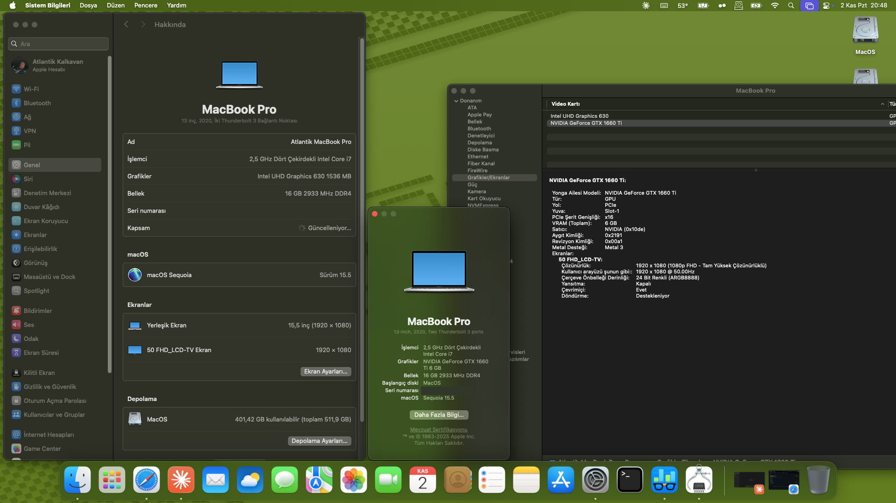

# ASUS TUF FX506LU Hackintosh (OpenCore)

ASUS TUF Gaming F15 **FX506LU** için OpenCore EFI'si. macOS 15.5 Sequoia'da test edildi.
Güncel sürüm, [nullmoth/nvidia-macos-driver](https://github.com/nullmoth/nvidia-macos-driver) ile
GTX 1660 Ti'yi (HDMI çıkışı üzerinden) Metal 3 hızlandırmayla çalıştıracak şekilde ayarlıdır.

> ⚠️ **SMBIOS bilgileri boştur.** Kullanmadan önce [GenSMBIOS](https://github.com/corpnewt/GenSMBIOS)
> ile kendi seri numaranızı, MLB, SystemUUID ve ROM değerlerinizi üretip `PlatformInfo` altındaki
> yer tutucuların yerine yazın (`Generic`, `DataHub`, `PlatformNVRAM`, `SMBIOS`).

## Sürümler

Her EFI sürümü bir git etiketiyle saklanır; eski sürümler her zaman indirilebilir.
Tüm sürümler: [Releases](../../releases) / [Tags](../../tags)

> NVIDIA'sız (dGPU kapalı, SIP açık) EFI ayrı bir depodadır:
> [atlntq/ASUS-TUF-FX506LU-Hackintosh](https://github.com/atlntq/ASUS-TUF-FX506LU-Hackintosh)

## Donanım

| Bileşen | Model | Durum |
|---|---|---|
| CPU | Intel Core i5-10300H (Comet Lake) | ✅ |
| iGPU | Intel UHD 630 (`0x3E9B0000`) | ✅ Dahili 1080p 144 Hz ekran |
| dGPU | NVIDIA GTX 1660 Ti Mobile (TU116, `10de:2191`) | ✅ nullmoth 2.6.6 ile, yalnızca HDMI |
| RAM | 16 GB | ✅ |
| SSD | Crucial MX500 (SATA) | ✅ |
| Ethernet | Realtek RTL8111 | ✅ |
| Wi-Fi / Bluetooth | Intel (AirportItlwm / IntelBluetoothFirmware) | ✅ |
| Ses | Realtek ALC (layout-id 17) | ✅ |
| Touchpad | I2C HID (VoodooI2C) | ✅ |
| Klavye ışığı / Fn tuşları | AsusSMC, BrightnessKeys, KBColor | ✅ |
| Pil | SMCBatteryManager + ECEnabler | ✅ |

## OpenCore ve kextler

**OpenCore 1.0.8** (REL-108)

| Kext | Sürüm |
|---|---|
| Lilu | 1.7.2 |
| VirtualSMC / SMCProcessor / SMCBatteryManager | 1.3.8 |
| WhateverGreen | 1.7.1 |
| AppleALC | 1.9.8 |
| AMFIPass | 1.4.1 |
| ECEnabler | 1.0.6 |
| VoodooPS2Controller | 2.3.7 |
| VoodooI2C / VoodooI2CHID | 2.9.1 / 1.0 |
| AirportItlwm (Sequoia) | 2.4.0 |
| IntelBluetoothFirmware / IntelBTPatcher | 2.4.0 / 2.5.0 |
| BlueToolFixup | 2.7.2 |
| RealtekRTL8111 | 3.0.0 |
| AsusSMC | 1.4.1 |
| BrightnessKeys | 1.0.3 |
| USBMap | 1.0 (bu makineye özel) |
| KBColor | 1.0.0 (klavye ışığı rengi, kendi kextim) |

Sürücüler: OpenRuntime, OpenCanopy, OpenHfsPlus, ResetNvramEntry.

## NVIDIA (GTX 1660 Ti) desteği

FX506LU'da MUX switch yoktur: dahili ekran Intel'e, **HDMI portu NVIDIA'ya** bağlıdır.
nullmoth sürücüsü kurulduğunda HDMI'deki ekran NVIDIA üzerinden Metal 3 ile çalışır,
dahili ekran Intel'de kalır.

NVIDIA için yapılan ayarlar:

- `ACPI > Add > SSDT-dGPU-Off.aml` **kapalı** (dosya duruyor)
- `-wegnoegpu` kaldırıldı
- boot-args: `nvfb=1 nvaccel=1 nvfbheads=4 -nvkmsnosmooth gfxrst=4 amfi_get_out_of_my_way=0x1 amfi=0x80 ipc_control_port_options=0`
- `Kernel > Block`: `com.apple.iokit.IONDRVSupport` (Exclude)
- `csr-active-config`: `430A0000`, `SecureBootModel`: `Disabled`
- AMFIPass.kext eklendi

> ⚠️ **Güvenlik:** Bu ayarlar SIP'i gevşetir, Secure Boot'u kapatır ve AMFI'yi devre dışı bırakır.
> İmzasız kernel uzantılarının yüklenebilmesi için gereklidir, ama sistemin güvenliğini ciddi
> şekilde azaltır. NVIDIA'ya ihtiyacınız yoksa [NVIDIA'sız EFI'yi](https://github.com/atlntq/ASUS-TUF-FX506LU-Hackintosh) kullanın.

### Kurulum

1. EFI'yi yerleştirin, SMBIOS'unuzu yazın ve açın.
2. [nullmoth sürücüsünün](https://github.com/nullmoth/nvidia-macos-driver/releases) release
   paketini indirin, `SHA256SUMS` ile doğrulayın.
3. Önce test modu: `sudo CHECK=1 ./install.sh`, ardından `sudo ./install.sh`.
4. Gizlilik ve Güvenlik'ten izin verin, iki kez yeniden başlatın. HDMI'ye monitör bağlı olsun.

### Bilinen sınırlamalar

- Dahili ekran NVIDIA ile sürülemez (Optimus/MUX desteği yok).
- Kart boştayken kapanmaz (RTD3/GC6 yok): pil süresi ve ısı kötüleşir.
- ReBAR yok, BAR1 256 MB. Benzer sistemlerde panic bildirilmiş
  ([nullmoth#451](https://github.com/nullmoth/nvidia-macos-driver/issues/451)).
- Turing desteği sürücü tarafında hâlâ "Pending" durumunda.

### Test

| | Intel UHD 630 | GTX 1660 Ti |
|---|---|---|
| Compute (4M × 256 FMA) | 31.5 ms (~205 GFLOPS) | 2.9 ms (~2220 GFLOPS) |
| Metal 3 / Arg. Buffers Tier 2 / RT | ✅ | ✅ |

## BIOS

- Secure Boot: kapalı
- CSM: kapalı
- Above 4G Decoding: açık (varsa)

## Lisans

Bu depodaki kextler, sürücüler ve OpenCore kendi projelerinin lisanslarına tabidir
(çoğu BSD-3-Clause, AirportItlwm/IntelBluetoothFirmware GPL-2.0). config.plist ve
SSDT'ler serbestçe kullanılabilir.
